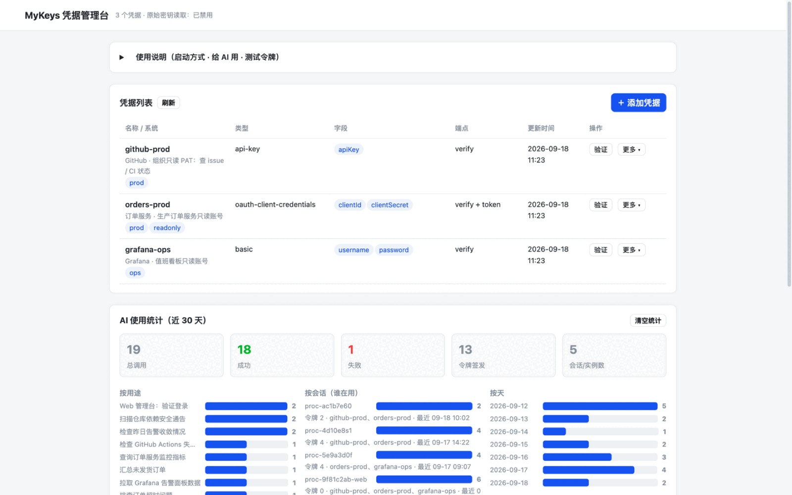
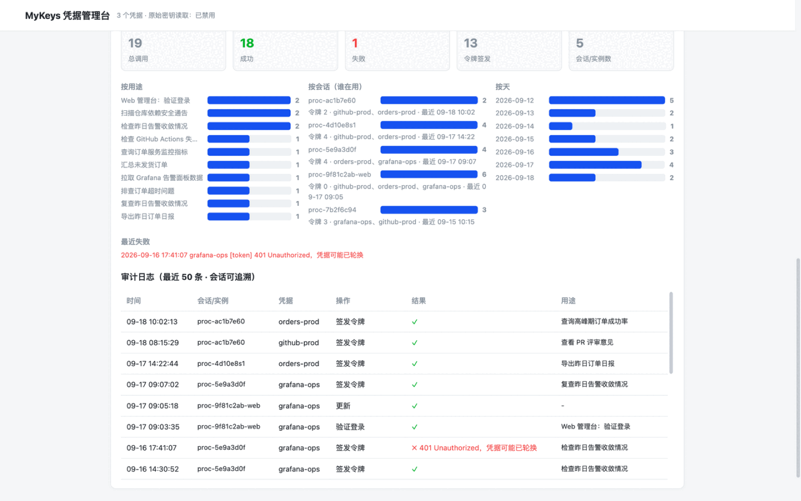
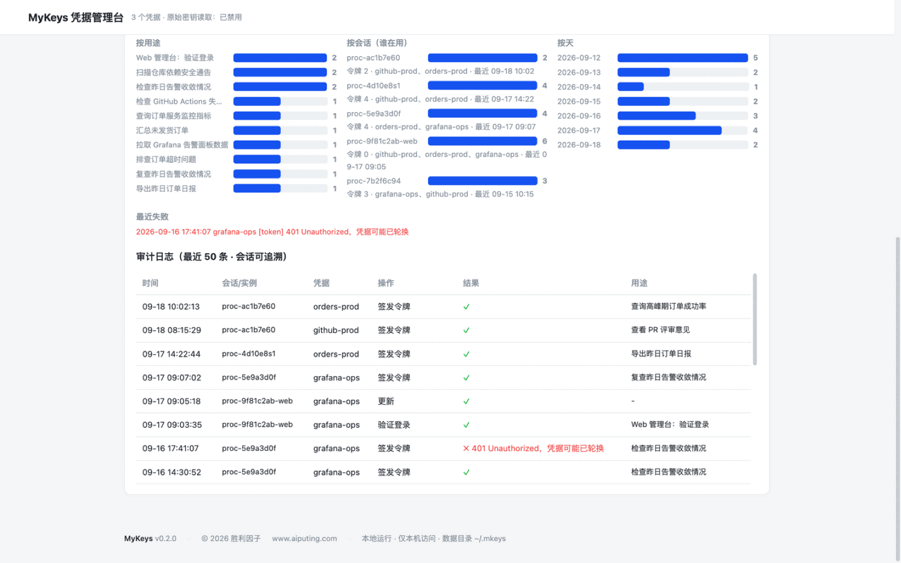
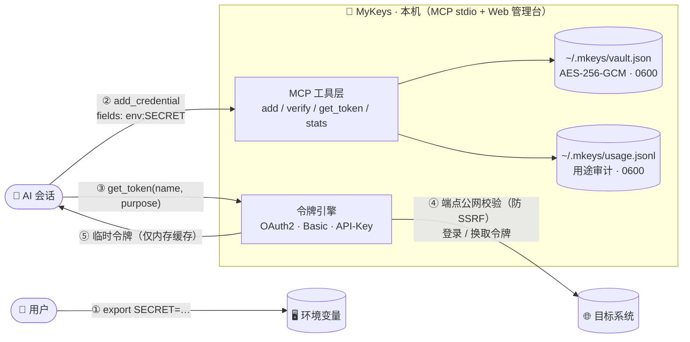
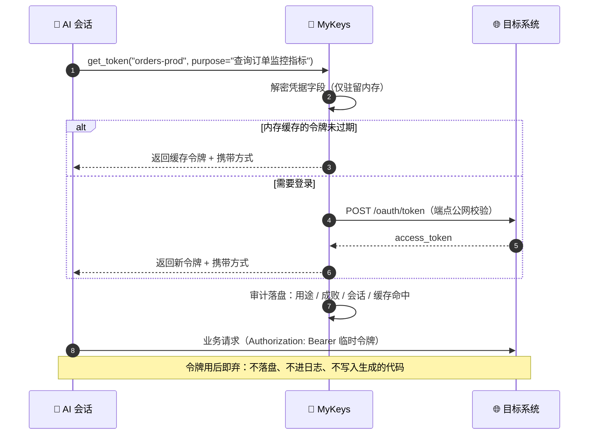
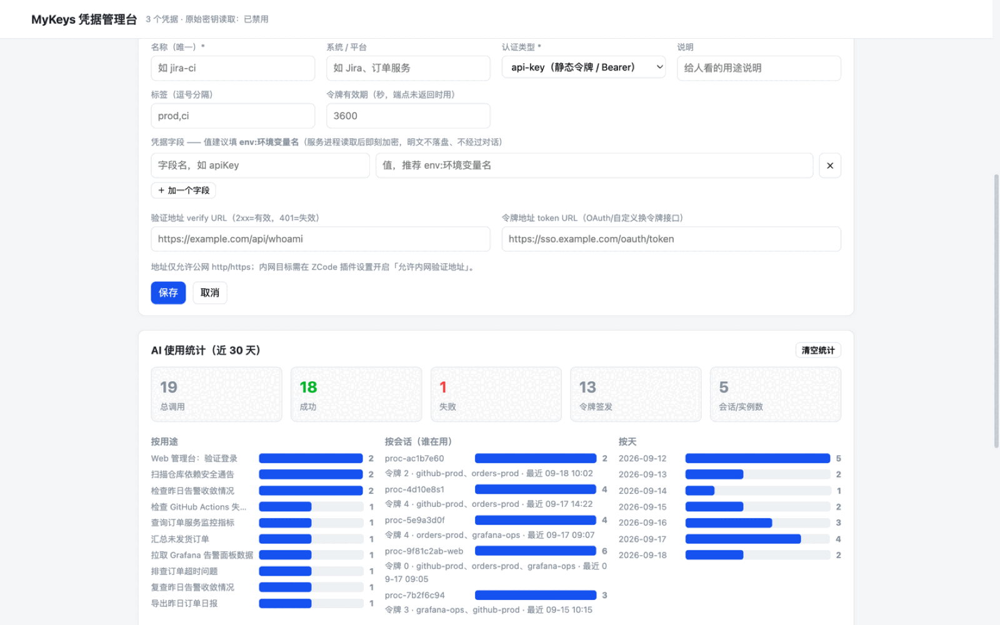

<div align="center">


# MyKeys <em>(mkeys)</em>

**本地优先的 AI 凭据保险库 —— 密钥不出本机，AI 只拿临时令牌，每次使用都可审计**

*A local-first credential vault for AI coding agents: secrets stay AES-256-GCM encrypted on
your machine, the AI only ever gets short-lived tokens, and every use is audited by purpose.*

[](LICENSE)
[](.zcode-plugin/plugin.json)
[](.mcp.json)
[](package.json)
[](package.json)
[](test/run-tests.js)

</div>

---

## 它解决什么问题

把密码 / API Key 交给 AI 编码助手，常见做法每一种都有代价：

- **粘贴进对话** —— 密钥进入聊天记录与云端日志，随会话导出、共享一路扩散；
- **写进 `.env` / 配置文件** —— 被一起提交进 Git，或被任意一段生成的代码直接读取；
- **每次手动复制** —— 相对安全，但 AI 无法端到端完成任务。

MyKeys 把这三者替换成一条**边界清晰的令牌通道**：

```text
密钥 ──▶ 加密保险库（本机） ──▶ AI 按用途换临时令牌 ──▶ 用后即弃，全程审计
```

AI 从不接触原始密钥（默认连读取接口都是禁用的），你随时可以回答那个最重要的问题：
**“我的密钥被 AI 用了多少次、用来干什么、是哪个会话用的？”**

## ✨ 核心特性

- 🔐 **加密存储** —— 凭据字段整体 AES-256-GCM 加密（AAD 绑定格式版本）；数据目录 0700、文件 0600、原子写入
- 🎫 **临时令牌** —— OAuth2 client-credentials / password、HTTP Basic、静态 API Key、自定义令牌端点（`{{field}}` 模板 + `tokenPath` 提取）；令牌只在内存缓存，过期自动重签，`refresh` 强制重登
- ✅ **登录验证** —— verify 端点（2xx / 401）或令牌流探活；管理台里一键测试
- 📊 **用途审计** —— 每次签发 / 验证 / 读密钥都记录用途、成败、会话、缓存命中，按凭据 / 用途 / 天聚合
- 🛡 **SSRF 防护** —— verify / token 端点仅允许公网 http/https，拒绝环回、私有、链路本地与保留网段（含域名解析后命中的情况）
- 🖥 **Web 管理台** —— 本地图形界面：表单添加（字段支持 `env:` 引用）、在线验证、签发令牌、统计图表
- 🪶 **零依赖** —— 纯 Node.js（≥ 18）内置模块实现 MCP stdio 协议，`git clone` 即用，无需 `npm install`

## 🖥️ 界面一览

| 凭据管理 | AI 使用统计 | 审计日志 |
| :---: | :---: | :---: |
|  |  |  |

> 截图中的凭据均为演示数据。页面为本地 Web 管理台（见下文），仅本机可访问。

## 🚀 快速开始

### 方式一：作为 ZCode 插件（推荐）

1. 打开 ZCode → **设置 → 插件管理 → 发现**页；
2. 点击 **`+`** 添加插件市场：填入本仓库的 GitHub 地址（或本地 clone 后的目录路径，仓库根目录已带 `marketplace.json`）；
3. 在市场中找到 **mkeys** 并安装启用。

安装后自动获得：`mkeys` MCP 服务器（9 个工具）、`/mykeys` 使用报告命令、`/mykeys-admin` 管理台命令，以及一个教 AI **何时、如何**使用这些工具的内置技能。

### 方式二：接入任意 MCP 客户端

MyKeys 是标准 MCP stdio 服务器，Claude Code / Cursor / 自研客户端均可直接接入：

```json
{
  "mcpServers": {
    "mkeys": {
      "type": "stdio",
      "command": "node",
      "args": ["/path/to/mkeys/server/index.js"],
      "env": { "MKEYS_ALLOW_REVEAL": "false" }
    }
  }
}
```

### 保存第一个凭据（3 步）

```sh
# ① 真实值只进环境变量，不进对话、不进文件
export ORDERS_CLIENT_ID=...
export ORDERS_CLIENT_SECRET=...
```

```text
② 对 AI 说："用 mkeys 保存订单服务的凭据，类型 oauth-client-credentials，
   clientId/clientSecret 用环境变量 ORDERS_CLIENT_ID / ORDERS_CLIENT_SECRET"
   → AI 调用 add_credential（字段写 env: 引用，服务端解析后即刻加密）

③ 之后直接说："查一下订单服务今天的错误率"
   → AI 调用 get_token(name, purpose) 换取临时令牌并发起请求
```

查账随时输入 `/mykeys`（最近 7 天报告），或在管理台看图表。

## 🔐 工作原理





## 🧰 MCP 工具

| 工具 | 说明 |
|---|---|
| `list_credentials` | 元数据列表（不含密钥明文） |
| `add_credential` / `update_credential` / `delete_credential` | 凭据增删改；字段值支持 `env:VAR_NAME` 间接引用 |
| `verify_login` | 验证登录有效性（2xx / 401） |
| `get_token(name, purpose)` | 签发 / 复用临时令牌，**purpose 必填**（用途审计的基石） |
| `reveal_secret` | 读取原始密钥，默认禁用；开启后每次调用都审计 |
| `usage_stats(sinceDays?)` | 使用统计报告（按凭据 / 用途 / 会话 / 天） |
| `open_admin` | 启动本地 Web 管理台，返回带访问令牌的地址 |

## 🖥️ Web 管理台

在 ZCode 里输入 `/mykeys-admin`（或让 AI “打开 MyKeys 管理页面”），也可以脱离 ZCode 独立运行：

```sh
node bin/mykeys.js admin     # 或 node server/webadmin.js
```



功能：凭据增删改查与表单添加（字段可写 `env:` 引用或直接输入，入库即加密）、在线验证登录、签发临时令牌、使用统计图表。

安全约束：仅绑定 `127.0.0.1`；访问令牌经 URL 传递并用 `timingSafeEqual` 比较（持久化于 `~/.mkeys/admin.token`，0600，重启后地址不变，也可用 `MKEYS_ADMIN_TOKEN` 指定）；校验 `Host` 头防 DNS rebinding；CSP 禁止一切外部资源。

## ⌨️ 斜杠命令与技能

| 名称 | 作用 |
|---|---|
| `/mykeys [天数\|all] [凭据名]` | 使用统计报告：AI 用了哪些密钥、几次、干什么、哪个会话；发现连续失败会提醒轮换 |
| `/mykeys-admin` | 打开本地 Web 管理台 |
| 技能 `mykeys` | 教 AI 何时、如何使用这些工具（密钥不过对话、purpose 必填、令牌优先、用后即弃） |

## ⚙️ 配置

| 环境变量 | 说明 |
|---|---|
| `MKEYS_HOME` | 数据目录，默认 `~/.mkeys` |
| `MKEYS_MASTER_KEY` | 主密钥：base64 的 32 字节，或任意口令（scrypt 派生）。未设置时首启自动生成 `~/.mkeys/master.key`（0600） |
| `MKEYS_ALLOW_REVEAL` | 是否允许 `reveal_secret` 读取原始密钥（也可用插件设置 `allowReveal`），默认 `false` |
| `MKEYS_ALLOW_PRIVATE_ENDPOINTS` | 允许 verify / token 端点指向环回 / 私有 / 保留地址（也可用插件设置 `allowPrivateEndpoints`），默认 `false`。仅可信内网环境开启 |
| `MKEYS_ADMIN_TOKEN` | Web 管理台访问令牌（默认读取 / 生成 `~/.mkeys/admin.token`） |
| `MKEYS_DEBUG` | 调试日志输出到 stderr |

**密钥来源约定**：凭据值只从环境变量进入 —— `add_credential` 的字段值写 `env:VAR_NAME`，
服务进程解析后即刻加密。密钥明文既不经过对话内容，也不落入源码 / 配置文件。

## 📖 示例：保存一个 OAuth 客户端凭据

先在启动 ZCode 的 shell 里导出真实值（示例变量名，勿写入任何文件）：

```sh
export ORDERS_CLIENT_ID=...      # 你的 client id
export ORDERS_CLIENT_SECRET=...  # 你的 client secret
```

然后对 AI 说“用 mkeys 保存订单服务的凭据”，等价于调用：

```json
add_credential({
  "name": "orders-prod",
  "system": "订单服务",
  "authType": "oauth-client-credentials",
  "fields": {
    "clientId": "env:ORDERS_CLIENT_ID",
    "clientSecret": "env:ORDERS_CLIENT_SECRET"
  },
  "endpoints": {
    "token": { "url": "https://sso.example.com/oauth/token" },
    "verify": { "url": "https://api.example.com/whoami" }
  },
  "description": "生产订单服务只读账号"
})
```

之后 AI 访问该系统时调用 `get_token({ "name": "orders-prod", "purpose": "查询订单监控指标" })`，
拿到的 `Authorization: Bearer <token>` 仅在本次任务的请求中使用。

## 🛡️ 安全模型

- 凭据字段整体加密为单条 GCM 密文（AAD 绑定格式版本），主密钥来自环境变量或本地密钥文件
- 令牌缓存仅在进程内存，进程退出即失效；不落盘、不进日志
- `usage.jsonl`（0600）记录时间、类型、凭据、**用途**、成败、缓存命中与**会话**；`usage_stats` 只读聚合
- 删除凭据不删除历史使用记录（审计留存）
- 明确不支持跳过 TLS 校验；内部 CA 请用 `NODE_EXTRA_CA_CERTS`
- SSRF 防护：服务端发请求前校验目标 —— 仅允许公网 http/https，拒绝 localhost、环回、私有、链路本地与保留网段（含域名解析后命中这些网段的情况）；可信内网目标需显式开启 `allowPrivateEndpoints`

### 数据目录（`~/.mkeys`）

| 文件 | 作用 | 权限 |
|---|---|---|
| `vault.json` | 加密凭据库 | 0600 |
| `usage.jsonl` | 审计 / 统计日志 | 0600 |
| `master.key` | 主密钥（未设 `MKEYS_MASTER_KEY` 时自动生成） | 0600 |
| `admin.token` | Web 管理台访问令牌 | 0600 |

## 🧪 测试

```sh
npm test   # 29 项：加密 / 保险库 / 认证流（本地假认证服务器）/ SSRF 地址防护 / 统计 / MCP 协议 / Web 管理台
```

## ❓ FAQ

**忘记 / 丢失主密钥怎么办？**
无法解密旧凭据 —— 这是设计使然。删除 `~/.mkeys` 重新初始化，并到目标系统轮换那些密钥。

**换机器或多机使用？**
整体打包 `~/.mkeys` 目录（含 `master.key`）即可；或设置 `MKEYS_MASTER_KEY` 后只拷 `vault.json`。

**我的系统在内网，verify 端点连不上？**
端点默认只允许公网地址（防 SSRF）。确认目标可信后，在插件设置开启 `allowPrivateEndpoints` 或设 `MKEYS_ALLOW_PRIVATE_ENDPOINTS=true`。

**AI 确实需要原始密钥怎么办？**
默认禁用的 `reveal_secret` 可通过 `allowReveal` 开启；每次读取都会记入审计。能用临时令牌就优先用令牌。

**和把密钥放 `.env` 里给 AI 读有什么区别？**
`.env` 是“全有或全无”：无审计、无过期、任何生成的代码都能读走全部内容。MyKeys 按用途签发临时令牌，全程留痕，随时可查、可吊销（删除凭据即可）。

## 📄 License

[MIT](LICENSE) © 2026 [胜利因子](https://www.aiputing.com/)

> 你的密钥永远只存在你自己的机器上 —— 本项目不含任何遥测或外部上报。
