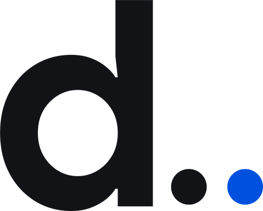
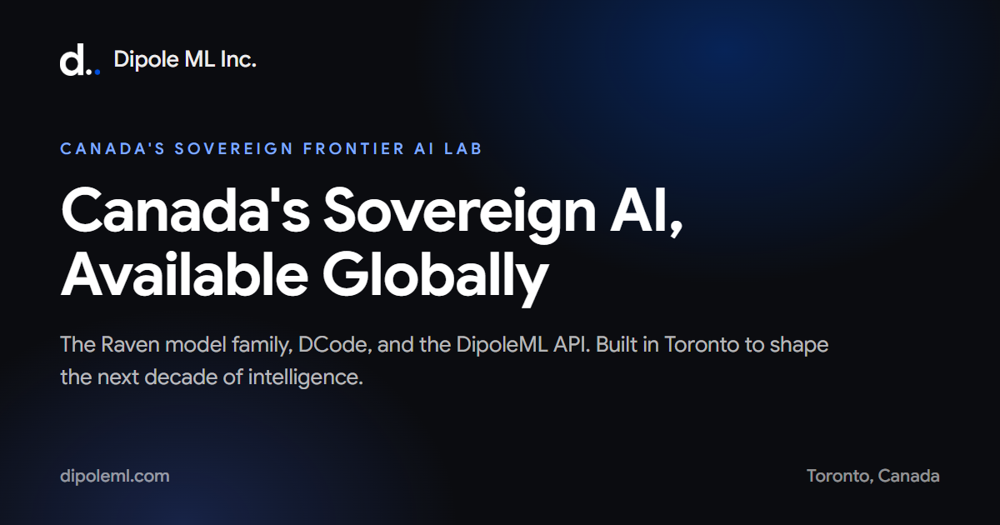

<p align="center">
  
</p>

<h1 align="center">DipoleML Catalog</h1>

<p align="center"><strong>MCP servers, AI skills, and plugins for the Raven Chat App and DCode Agentic Harness.</strong></p>

<p align="center"><em>Canada's Sovereign Intelligence · Made in Canada</em></p>

<p align="center">
  
  
  
  
  
</p>



**Quick answer:** The **DipoleML Catalog** is a curated, machine-readable collection of **259 Model Context Protocol (MCP) servers, 500 plugins, and 1,000 AI skills** (1,759 validated integrations in total). It is maintained by **Dipole ML Inc.** in Toronto, Canada, and powers the MCP, skill, and plugin marketplaces inside the **Raven Chat App** and **DCode Agentic Harness**.

---

## Contents

- [What is the DipoleML Catalog?](#what-is-the-dipoleml-catalog)
- [Built for Raven and DCode](#built-for-raven-and-dcode)
- [What's inside](#whats-inside)
- [Featured integrations](#featured-integrations)
- [Repository structure](#repository-structure)
- [How the marketplace consumes it](#how-the-marketplace-consumes-it)
- [Curation and quality](#curation-and-quality)
- [Getting started](#getting-started)
- [FAQ](#faq)
- [About Dipole ML Inc.](#about-dipole-ml-inc)
- [Licensing and attribution](#licensing-and-attribution)
- [Contributing and security](#contributing-and-security)

## What is the DipoleML Catalog?

The DipoleML Catalog is the integration layer for Dipole ML's agent products. Each entry describes one capability an AI agent can use, such as a database connector, a browser tool, a document workflow, a coding skill, or a design plugin, in a format the Raven Chat App and DCode Agentic Harness can load consistently.

Every entry ships with:

- a **`dipoleml.json`** manifest (the source of truth),
- a human-readable **`DIPOLEML.md`** page,
- the upstream project's **license and copyright notices**,
- a **company or project logo** with provenance in `logo.json`,
- a concrete **entrypoint** for MCP servers, plugins, or skills.

The catalog is curated, not a raw scrape. Entries are pinned to upstream commits, checked for license compatibility, normalized to the **DipoleML** provider identity, and validated before they enter the marketplace.

**Keywords:** MCP catalog, Model Context Protocol servers, AI skills, AI plugins, agent skills, agentic development environment, AI agent marketplace, sovereign AI, Raven Chat App, DCode Agentic Harness, Dipole ML Inc.

## Built for Raven and DCode

| Product | What it is | How it uses this catalog |
|---|---|---|
| **Raven Chat App** | Dipole ML's cross-platform AI assistant, available on web, Windows, macOS, and mobile. | Populates its marketplace with MCP connectors, skills, and plugins so users can extend Raven without leaving the app. |
| **DCode Agentic Harness** | Dipole ML's Agentic Development Environment (ADE) and CLI, built for repository-aware planning, edits, shell execution, and test verification. | Supplies MCP servers, developer plugins, and coding skills for the DCode marketplace and one-click MCP connections. |
| **DipoleML API** | An OpenAI- and Anthropic-compatible API surface at `api.dipoleml.com`. | Provides the model layer beneath both products; the catalog describes the tools those models can call. |

One catalog. One schema. One quality bar. Both products read the same source of truth.

## What's inside

| Type | Count | What it provides |
|---|---:|---|
| **MCP servers** | 259 | Model Context Protocol servers for data, APIs, browsers, developer tools, productivity, and business systems. |
| **Plugins** | 500 | Installable agent packages containing commands, skills, hooks, MCP connections, or workflow extensions. |
| **Skills** | 1,000 | Focused, reusable capabilities for writing, documents, research, coding, design, marketing, sales, finance, HR, legal, education, and everyday productivity. |
| **Total** | **1,759** | Every item validated, logoed, and license-checked. |

The skill set is deliberately curated rather than exhaustive: high-signal workflows for everyday users and developers, with duplicate names collapsed and internal/test/demo skills filtered out.

## Featured integrations

| Integration | Type | What it enables |
|---|---|---|
| [Notion MCP Server](MCP/notion/notion-mcp-server/DIPOLEML.md) | MCP | Read and write Notion pages, databases, and workspace content. |
| [GitHub MCP Server](MCP/github/github-mcp-server/DIPOLEML.md) | MCP | Work with repositories, issues, pull requests, and code search. |
| [Figma Context MCP](MCP/figma/figma-context-mcp/DIPOLEML.md) | MCP | Give agents design context from Figma files. |
| [Playwright MCP](MCP/microsoft/playwright-mcp/DIPOLEML.md) | MCP | Browser automation and testing through Playwright. |
| [Chrome DevTools MCP](MCP/google/chrome-devtools-mcp/DIPOLEML.md) | MCP | Inspect pages, performance, and browser state. |
| [Firecrawl MCP Server](MCP/firecrawl/firecrawl-mcp-server/DIPOLEML.md) | MCP | Search, crawl, and scrape the web into clean context. |
| [Apify MCP Server](MCP/apify/apify-mcp-server/DIPOLEML.md) | MCP | Access Apify actors, datasets, and web automation. |
| [MCP for Blender](MCP/blender/mcp-for-blender/DIPOLEML.md) | MCP | Drive Blender scenes and motion workflows. |
| [Google Workspace MCP](MCP/taylorwilsdon/google-workspace-mcp/DIPOLEML.md) | MCP | Work with Gmail, Calendar, Drive, Docs, and Sheets. |
| [Slack MCP Server](MCP/korotovsky/slack-mcp-server/DIPOLEML.md) | MCP | Search and interact with Slack workspaces. |
| [WhatsApp DipoleML Plugin](Plugins/rich627/whatsapp-dipoleml-plugin/DIPOLEML.md) | Plugin | Run agent workflows through WhatsApp. |
| [Asana](Plugins/anthropic/asana/DIPOLEML.md) | Plugin | Project and task operations in Asana. |
| [Linear MCP Server](MCP/jerhadf/linear-mcp-server/DIPOLEML.md) | MCP | Issue and project workflows in Linear. |
| [Discord](Plugins/anthropic/discord/DIPOLEML.md) | Plugin | Discord messaging and community operations. |
| [Telegram MCP](MCP/chigwell/telegram-mcp/DIPOLEML.md) | MCP | Telegram messaging and channel workflows. |
| [Humanizer](Skills/blader/humanizer/DIPOLEML.md) | Skill | Rewrite AI-sounding prose into natural writing. |
| [PDF](Skills/yusufkaraaslan/pdf/DIPOLEML.md) | Skill | Extract, inspect, and work with PDF documents. |
| [Code Review and Quality](Skills/addyosmani/code-review-and-quality/DIPOLEML.md) | Skill | Review code for correctness, maintainability, and quality. |

## Repository structure

```text
.
├── README.md
├── marketplace.json              # Marketplace entrypoint (counts + paths)
├── Catalog/
│   ├── catalog.json              # Full machine-readable catalog (1,759 items)
│   ├── schema.json               # JSON Schema for dipoleml.json
│   ├── INDEX.md                  # Compact human-readable summary
│   ├── indexes/                  # Small per-type index files
│   ├── attribution.csv           # id, repo, commit, license, path
│   └── excluded-repositories.json
├── MCP/                          # 259 MCP servers
├── Plugins/                      # 500 plugins
├── Skills/                       # 1,000 skills
├── assets/                       # Dipole ML brand assets used by this README
└── docs/
    ├── CATALOG_FORMAT.md
    └── LICENSING.md
```

Each item follows the same shape:

```text
MCP/<vendor>/<slug>/
├── dipoleml.json                 # DipoleML manifest
├── DIPOLEML.md                   # Human-readable page
├── logo.svg | logo.png           # Company/project logo
├── logo.json                     # Logo provenance
├── LICENSE / NOTICE              # Upstream license(s)
├── _upstream/                    # Archived provider manifests
└── ... upstream source ...
```

## How the marketplace consumes it

1. Read [`marketplace.json`](marketplace.json) for counts and entry paths.
2. Load [`Catalog/catalog.json`](Catalog/catalog.json) for the full item list.
3. For each item, read its `dipoleml.json` and resolve the entrypoint:

| Entrypoint kind | Meaning |
|---|---|
| `mcp-stdio` | Spawn a local MCP server over standard I/O. |
| `mcp-http` / `mcp-sse` | Connect to a hosted MCP endpoint. |
| `plugin` | Load `.dipoleml-plugin/plugin.json` and its commands/skills. |
| `skill` | Load `SKILL.md` as an agent skill. |

Example manifest:

```json
{
  "id": "mcp.notion.notion-mcp-server",
  "type": "mcp",
  "name": "Notion MCP Server",
  "provider": "DipoleML",
  "source": {
    "repo": "makenotion/notion-mcp-server",
    "license": "MIT"
  },
  "entrypoints": [
    {
      "kind": "mcp-stdio",
      "command": "npx",
      "args": ["-y", "@notionhq/notion-mcp-server"]
    }
  ],
  "logo": {
    "file": "logo.svg",
    "brand": "notion"
  }
}
```

The full field reference is in [`docs/CATALOG_FORMAT.md`](docs/CATALOG_FORMAT.md) and [`Catalog/schema.json`](Catalog/schema.json).

## Curation and quality

- **License allowlist.** Only permissive licenses are vendored: MIT, Apache-2.0, BSD-2-Clause, BSD-3-Clause, ISC, MPL-2.0, CC0-1.0, and Unlicense. 491 repositories with unknown, missing, share-alike, or copyleft terms are catalogued separately in [`Catalog/excluded-repositories.json`](Catalog/excluded-repositories.json) and are not redistributed here.
- **Provider-neutral.** Every item presents the **DipoleML** provider identity. Upstream provider manifests are archived under `_upstream/`; executable code is not rewritten.
- **Attribution preserved.** Every item keeps its upstream license, copyright notices, repository URL, and pinned commit. See [`Catalog/attribution.csv`](Catalog/attribution.csv).
- **Selection, not scraping.** Skills are scored by upstream adoption, official-vendor signal, name quality, and category fit. Duplicate names are collapsed, and internal/test/demo skills are excluded.
- **Validated.** 1,759 of 1,759 items pass schema and integrity checks: 0 failures, 0 warnings, 0 duplicate IDs, full logo coverage.
- **Distribution snapshot.** Dependency caches (`node_modules`, virtualenvs), nested CI workflows, real `.env` files, and upstream test suites for MCP/plugin packages are omitted from this public snapshot to keep clones small and safe. Runtime source, manifests, licenses, logos, and skill assets are preserved.

| Quality signal | Result |
|---|---:|
| Items validated | 1,759 |
| Validation failures | 0 |
| Duplicate IDs | 0 |
| Items with license file | 1,759 |
| Items with logo | 1,759 |
| Excluded repositories (license policy) | 491 |

See [CATALOG_STATS.md](CATALOG_STATS.md) for license, vendor, logo, and index breakdowns.

## Getting started

Clone the repository and point your marketplace loader at `Catalog/catalog.json`:

```bash
git clone https://github.com/dipoleml/dipoleml-catalog.git
cd dipoleml-catalog
python3 -m json.tool marketplace.json
python3 -m json.tool Catalog/catalog.json | head
```

If you are mirroring the catalog, update the clone URL and keep `provider: "DipoleML"` and the `source.repo` attribution intact.

To inspect a single integration, open its `DIPOLEML.md` page or read its `dipoleml.json` directly. Index files under `Catalog/indexes/` are intentionally split into small files so they open quickly in editors and browsers.

## FAQ

### What is the DipoleML Catalog?

The DipoleML Catalog is Dipole ML Inc.'s curated collection of MCP servers, plugins, and skills used by the Raven Chat App and DCode Agentic Harness to populate their marketplaces. It currently contains 1,759 validated integrations.

### What is an MCP server?

An MCP server implements the Model Context Protocol, an open standard that lets AI agents call external tools and data sources through a consistent interface. Examples include Notion, GitHub, Figma, Slack, and browser automation servers.

### What is an AI skill?

A skill is a focused, reusable instruction package, usually a `SKILL.md` file plus supporting references, that teaches an agent how to perform a specific task, such as editing prose, reviewing code, analyzing a spreadsheet, or preparing a presentation.

### What is an AI plugin?

A plugin is an installable package that can bundle commands, skills, hooks, MCP connections, or workflow extensions. In this repository, plugin manifests live in `.dipoleml-plugin/plugin.json`.

### Which Dipole ML products use this catalog?

The **Raven Chat App** and **DCode Agentic Harness** use it as the source of truth for their MCP, skill, and plugin marketplaces. The DipoleML API provides the model layer beneath both.

### How many integrations are included?

259 MCP servers, 500 plugins, and 1,000 skills (1,759 items in total).

### How are integrations selected?

By upstream adoption, official-vendor signal, license compatibility, structural validity, name deduplication, and category coverage across everyday work and software development.

### Are all integrations open source?

The included items use the permissive licenses listed in [Curation and quality](#curation-and-quality). Repositories that did not pass the license policy are excluded from redistribution and listed separately for review.

### How do updates work?

Each item is pinned to an upstream commit in `dipoleml.json`. Updating an integration means reviewing the upstream diff, re-vendoring it, and re-running validation. The catalog is designed for reviewed updates, not silent background replacement.

### Can I contribute?

Yes. See [`CONTRIBUTING.md`](CONTRIBUTING.md) for the license allowlist, manifest requirements, brand-neutralization rules, and review process.

### Is my data safe?

The catalog itself contains no credentials or user data. Runtime data handling is determined by each MCP server or plugin and by Dipole ML's platform policies: data is encrypted at rest, never sold, and served under Canadian jurisdiction. See the [Dipole ML privacy page](https://dipoleml.com/privacy).

## About Dipole ML Inc.

**Dipole ML Inc.** is a Toronto-based Canadian sovereign frontier AI lab. It builds and serves frontier intelligence from Canada: models, an agentic development environment, and an independent API, under three engineering pillars: **access, autonomy, and trust**. Data is handled under Canadian jurisdiction with PIPEDA and GDPR alignment; customer data is never sold.

The company began in 2022 as a self-funded research effort by founder and president **Saurabh Sharma**, without outside venture capital. After four years building the full stack, Dipole ML launched globally on **October 1, 2026** with the Raven model family, DCode 1.0, and the DipoleML API.

- **Raven Max**: the flagship model for complex engineering, long-horizon planning, and auditable reasoning.
- **Raven Flash**: the low-latency, high-throughput default engine in DCode and the Raven app.
- **Raven Chat App**: the cross-device assistant experience.
- **DCode Agentic Harness**: the Agentic Development Environment (ADE) and CLI for repository-aware software work.
- **DipoleML API**: OpenAI- and Anthropic-compatible endpoints at `api.dipoleml.com`.

> **Canada's Sovereign Intelligence.** Private by design. Defended by default. Made in Canada.
>
> *The frontier has a northern address.*

- Website: [dipoleml.com](https://dipoleml.com)
- Raven: [dipoleml.com/raven](https://dipoleml.com/raven)
- DCode: [dipoleml.com/dcode](https://dipoleml.com/dcode)
- Models: [dipoleml.com/models](https://dipoleml.com/models)
- API docs: [docs.dipoleml.com](https://docs.dipoleml.com)
- General contact: [hello@dipoleml.com](mailto:hello@dipoleml.com)
- Developers, security, and licensing: [developer@dipoleml.com](mailto:developer@dipoleml.com)
- X: [@dipoleml](https://x.com/dipoleml)
- LinkedIn: [Dipole ML](https://linkedin.com/company/dipoleml)
- Instagram: [@dipoleml](https://instagram.com/dipoleml)
- Facebook: [dipoleml](https://facebook.com/dipoleml)

## Licensing and attribution

The **catalog metadata, indexes, and documentation** in this repository are licensed under **Creative Commons Attribution 4.0 International (CC BY 4.0)**. You may share and adapt them with attribution to Dipole ML Inc.

**Third-party integrations remain under their upstream licenses.** Each item's `LICENSE`, `NOTICE`, and `dipoleml.json.source` fields identify the original repository, commit, and license. Nothing in this repository relicenses upstream code. Brand names and logos belong to their respective owners and are used to identify integrations.

See [`LICENSE`](LICENSE), [`NOTICE.md`](NOTICE.md), and [`docs/LICENSING.md`](docs/LICENSING.md) for the full scope.

## Contributing and security

- **Contributions:** [`CONTRIBUTING.md`](CONTRIBUTING.md)
- **Security reports:** [`SECURITY.md`](SECURITY.md)
- **Machine-readable summary:** [`llms.txt`](llms.txt)
- **Citation metadata:** [`CITATION.cff`](CITATION.cff)

---

<p align="center"><strong>Dipole ML Inc.</strong> · Toronto, Ontario, Canada · <em>Built with conviction. Bootstrapped from day one.</em></p>
